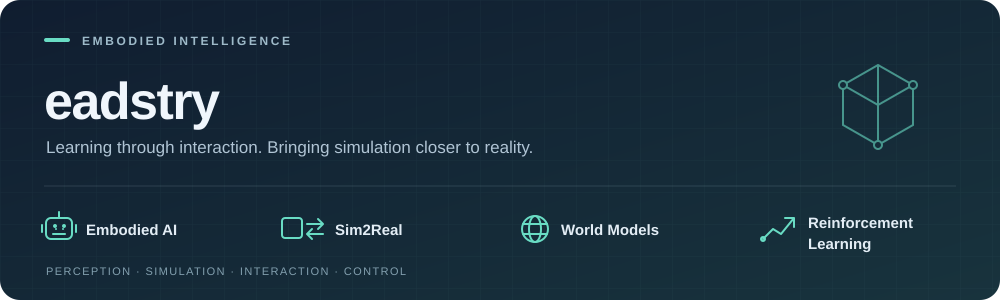

  

### About me

I'm interested in **embodied AI, Sim2Real, world models, and reinforcement learning**. I explore how agents perceive their environment, learn through interaction, and transfer capabilities from simulation to the real world.

My current work focuses on **robotics data generation, domain randomization, and simulation-based evaluation**, with an emphasis on reproducible experiments and practical tooling.
